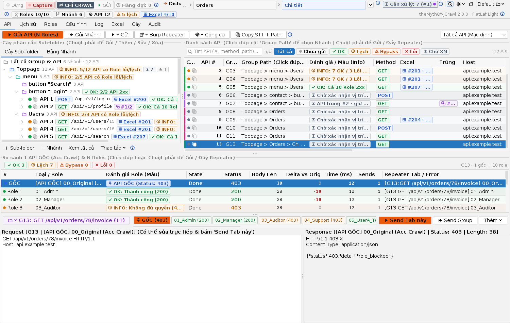
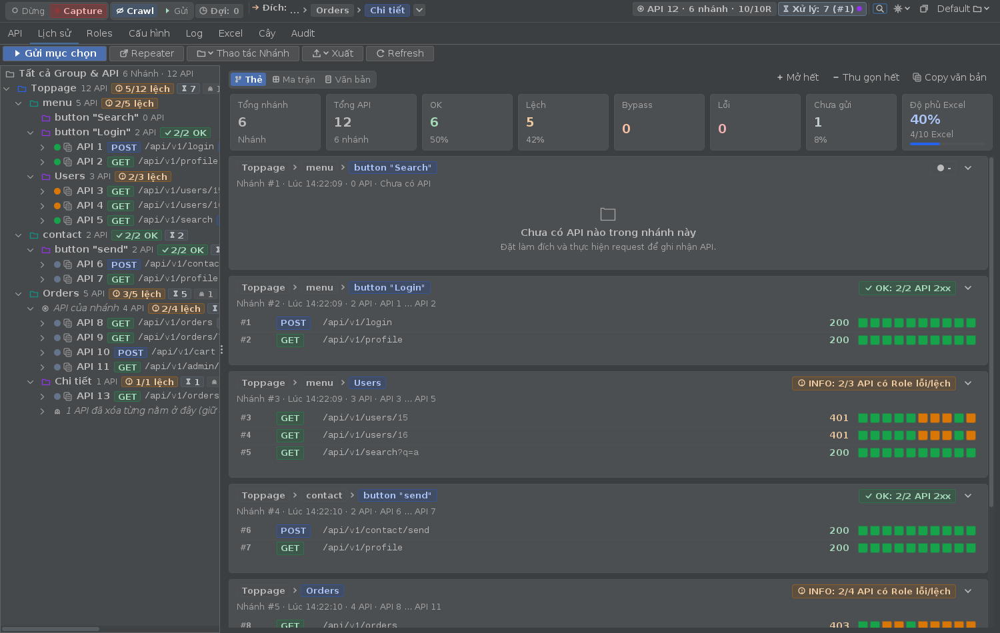
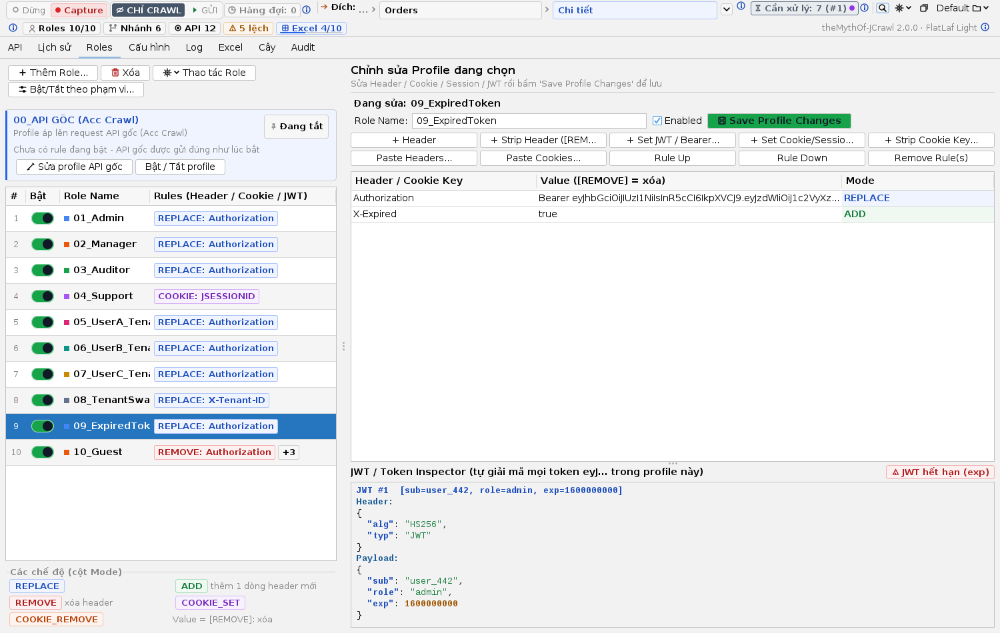

# theMythOf-JCrawl (Java / Montoya) - V_7.0_beta

Burp Suite extension viết bằng **Java 21 + Montoya API**: bản viết lại toàn bộ của
[theMythOf-PCrawl](https://github.com/hau2212/theMythOfCrawl) (bản Python / Jython) - đủ mọi chức năng,
nhanh hơn, có lưu dữ liệu ra đĩa (workspace), **không cần Jython**, và giao diện tự thích ứng cả
**Light / Dark theme** của Burp Suite (icon vẽ hoàn toàn bằng Java2D, không phụ thuộc emoji).

## Điểm mới V_7.0_beta


- **Bảng API kiểu Burp HTTP History**: `# | Method | Host | Path | Status | Length | Kết quả Role | Nhánh | Đánh giá | Time`,
  Path luôn thẳng một cột; cột ít dùng (Group, Copy, Đã copy, Source, Đã gửi...) ẩn mặc định — chuột phải lên header để bật lại.
- **Kết quả Role dạng heatmap**: mỗi role một ô màu ngay trên dòng API (xanh OK · vàng bị chặn/lệch · cam bypass · đỏ lỗi · xám chưa gửi).
- **Cây chỉ hiển thị nhánh** (giống Site map) để lọc bảng; kéo dòng từ bảng thả vào nhánh để chuyển. Muốn kiểu cũ: `Bố cục ▾ → Hiện từng API trong cây`.
- **Ẩn/hiện mọi khung** để tối đa không gian:

  | Phím | Tác dụng |
  |---|---|
  | `Ctrl+Alt+1` | Ẩn/hiện cây nhánh |
  | `Ctrl+Alt+2` | Ẩn/hiện khung chi tiết (Role + Request/Response) |
  | `Ctrl+Alt+3` | Ẩn/hiện thanh công cụ tab API |
  | `Ctrl+Alt+H` | Ẩn/hiện thanh trên cùng |
  | `Ctrl+Alt+0` | Chế độ Tối đa: chỉ còn bảng API (bấm lại để thoát) |

  Nút **Bố cục ▾** có sẵn 3 bố cục Crawl / Phân tích / Tối đa; trạng thái được nhớ giữa các lần mở Burp.
- **Đồng bộ nhóm an toàn hơn**: phòng nhóm chỉ nghe `127.0.0.1` theo mặc định, bắt buộc passcode ≥ 8 ký tự.
  Mở cho LAN phải bật riêng (có cảnh báo SOC). Xem phương án đồng bộ an toàn và lộ trình trong [`docs/V7_PLAN.md`](docs/V7_PLAN.md).

## Giao diện (Light & Dark)

| Tab API (FlatLaf Light) | Tab API (FlatLaf Dark) |
|---|---|
|  |  |

| Lịch sử trực quan - Heatmap theo Role (Dark) | Tab Roles & JWT Inspector (Light) |
|---|---|
|  |  |

## Cài đặt - chỉ cần 1 file

1. Tải **`theMythOf-JCrawl.jar`**: [link tải trực tiếp](https://github.com/hau2212/theMythOf-JCrawl/releases/latest/download/theMythOf-JCrawl.jar)
   (hoặc mục **Releases** bên phải trang repo). GitHub tự build lại mỗi lần có commit mới trên `main`.
2. Để file vào **một thư mục riêng**, ví dụ `D:\Tools\JCrawl\theMythOf-JCrawl.jar`.
   Dữ liệu sẽ được lưu ngay cạnh file: `D:\Tools\JCrawl\theMythOfCrawl_workspace\`.
3. Burp → **Extensions → Installed → Add** → Extension type **Java** → chọn file `.jar` → Next.
   Tab **`theMythOf-JCrawl`** xuất hiện trên thanh tab của Burp.

Không cần cài Jython, Python hay thư viện nào khác. Cần Burp Suite bản mới (có sẵn Java 21; bản 2024 trở lên).

**Cập nhật bản mới:** tải jar mới, ghi đè đúng file cũ (cùng thư mục) → trong Burp, Ctrl + click ô
*Loaded* của extension để nạp lại. Workspace (dữ liệu đã bắt) giữ nguyên.

**Tự build** (cần JDK 21): `gradlew.bat build` (hoặc `./gradlew build` trên Linux/macOS) → file ở
`build/libs/theMythOf-JCrawl.jar` (khi chạy từ `build/libs`, workspace nằm ở thư mục gốc của repo).

### Gặp lỗi giao diện (mất màu / ô vuông emoji / vẫn thấy giao diện cũ)

1. Mở **Extensions → Installed → chọn `theMythOf-JCrawl` → Output**, kiểm tra dòng nạp:
   `theMythOf-JCrawl 2.0.0 loaded · LAF=... · dark=...`
2. Kiểm tra tên tab trên thanh tab Burp là **`theMythOf-JCrawl`**. Nếu không có dòng Output trên hoặc tên tab vẫn là tên cũ → Burp đang nạp file `.jar` cũ; hãy **Unload / Remove** extension cũ và **Add** lại file `theMythOf-JCrawl.jar` mới nhất.
3. Mở tab **Cấu hình → mục 8. Giới thiệu & chẩn đoán** (hoặc rê chuột vào chip trạng thái trên header) để xem phiên bản, LAF, màu `Panel.background` / `Table.background` / `Component.accentColor`, hệ số scale và cỡ chữ (`90% / 100% / 115%`); bấm **Copy thông tin chẩn đoán** nếu cần gửi kèm ảnh chụp màn hình.

## Dùng nhanh

1. Tab **Roles**: sửa các role mẫu (token / cookie / JWT của từng tài khoản test), tắt role không dùng bằng switch gạt.
   Thẻ **API gốc** ghim trên cùng áp rule trực tiếp lên request đã bắt (nếu bật).
2. Thanh trên cùng (2 hàng gọn): bấm vào **Đích** (dạng **Breadcrumb** tô màu từng cấp) hoặc mũi tên bên cạnh để chọn
   nhánh đích, ví dụ `Toppage > contact > button "send"` - mọi request mới sẽ vào nhánh này cho tới khi bạn đổi.
3. Bật nút gạt **Dừng / Capture** (có chấm đỏ nhấp nháy nhẹ khi đang bắt), duyệt web qua Proxy của Burp. Mỗi API được
   bắt sẽ nhân bản thành 1 API gốc + N role.
4. Gạt **CHỈ CRAWL / GỬI** sang **GỬI** (tự gửi mọi role theo hàng đợi chống 429 có thanh tiến độ mảnh), hoặc chọn API /
   nhánh rồi bấm **Gửi** (`Ctrl+Enter`). Màu trạng thái: xanh lá = OK, vàng hổ phách = role bị chặn / lệch quyền, cam =
   nghi bypass (Guest vẫn 2xx), đỏ = lỗi server, xanh dương = 3xx / chưa gửi, xám = chờ xác nhận vị trí.
5. Pill **Cần xử lý** (thanh trên cùng / tab **Audit**): xác nhận vị trí API mới, API quay về chỗ cũ, API trùng.
6. (Tùy chọn) Tab **Excel** → nạp danh sách API (`STT | PROTOCOL | PATH | POSITION`) để theo dõi độ phủ qua KPI **StatCard**;
   bấm icon Copy ở đầu dòng hoặc `Ctrl+Shift+C` để copy `STT. path`.
7. Xuất kết quả: tab **Lịch sử** → **Xuất** (Excel 7 sheet, báo cáo `.md`, ma trận JSON).

Mọi thao tác chính đều hiển thị thông báo nổi không chặn (**Toast trượt**) kèm nút **Hoàn tác** khi kéo thả di chuyển API, và có icon trợ giúp hình chữ `i` mở popover chi tiết.

## Các tab & điểm mới

| Tab | Nội dung & Cải tiến |
|---|---|
| **Thanh trên cùng** | Thiết kế 2 hàng (`<= 64 px`) vừa màn hình hẹp 1100 px: toggle **Dừng / Capture**, **CHỈ CRAWL / GỬI**, **Hàng đợi**, **Đích** dạng Breadcrumb từng cấp, pill **Cần xử lý**, tìm kiếm nhanh `Ctrl+K`, tùy chọn, tách cửa sổ, Workspace và dải chip thống kê bấm-lọc nhanh |
| **API** | Cây Sub-folder hỗ trợ **kéo thả API sang nhánh khác** (có Hoàn tác) và chip bấm trực tiếp Copy / Excel / Trùng; bảng API có **ô lọc nhanh (`Ctrl+F`)**, **dải chip lọc nhiều trạng thái cùng lúc**, **nhớ độ rộng / thứ tự / ẩn cột** (chuột phải lên header cột để chỉnh, key `tmoc.ui.columns.*`); bảng kết quả role kèm dải tổng hợp `OK / Lệch / Bypass / Lỗi` và luôn ghim hàng **GỐC** ở đầu khi sort; editor Pretty / Raw / Hex của Burp giữ nguyên bên dưới |
| **Lịch sử** | Báo cáo trực quan **HistoryReportView**: dải 8 **StatCard KPI** (nhánh, API, OK, Lệch, Bypass, Lỗi, Chưa gửi, % Excel) + 3 chế độ xem (**Thẻ** theo nhánh kèm ma trận ô vuông heatmap từng role — bấm để nhảy tới đúng API & Role ở tab API; **Ma trận** bảng Role × API tô màu trạng thái; **Văn bản** thuần để đọc/copy) |
| **Roles** | Thẻ **API gốc** ghim đầu; danh sách role dạng thẻ với avatar tròn 2 chữ cái, switch gạt và chip rule màu theo mode (`REPLACE`, `ADD`, `REMOVE`, `COOKIE_SET`, `COOKIE_REMOVE`); **JWT Inspector** tô màu cú pháp JSON header/payload kèm nhãn cảnh báo `exp` hết hạn / còn hạn |
| **Cấu hình** | 8 mục thẻ màu bố cục lưới 2 cột (tự chuyển 1 cột khi hẹp), ô tìm kiếm cài đặt ở trên cùng, placeholder + viền đỏ khi regex sai; **Mục 8** thêm chỉnh **cỡ chữ giao diện (`90% / 100% / 115%`)**, bật/tắt animation nhẹ (`<= 150 ms`) và copy thông tin chẩn đoán |
| **Log** | Cây tải lười nhánh → API → dòng log (giờ monospace + icon Java2D theo loại + tô màu dòng lỗi) kèm ô tìm kiếm và chip lọc **Bắt / Gửi / Lỗi / Di chuyển / Hệ thống** |
| **Excel** | Màn hình chờ **EmptyState** khi chưa nạp file; 4 thẻ KPI độ phủ + chip lọc nhanh + bảng timeline lịch sử các lần gặp (icon kết quả, giờ, vị trí đang đứng → nhánh lưu) |
| **Cây** | Cây lớn kèm thanh **Breadcrumb** theo nhánh/API đang chọn, đồng bộ tiêu đề cửa sổ khi bấm **Mở cửa sổ riêng** |
| **Audit** | 4 tab con dạng thẻ (`tabType=card`) có số đếm: **Cần xử lý** kèm thẻ **Chi tiết quyết định** chứa nút xử lý trực tiếp, **Giữ chỗ**, **API trùng & ẩn**, và **Nhật ký** tô màu theo hành động (hoàn tác được) |

## Phím tắt

| Phím tắt | Chức năng |
|---|---|
| `Ctrl+K` | Mở **Spotlight** tìm kiếm toàn cục (nhảy nhanh tới API theo `#gid` / path / STT Excel, Nhánh, hoặc Role) |
| `Ctrl+F` | Focus ô lọc / tìm kiếm trong tab hiện tại |
| `Ctrl+Shift+C` | Copy `STT. path` cho các API / nhánh đang chọn |
| `Ctrl+Enter` | Gửi API / phạm vi đang chọn qua N Roles |
| `Ctrl+R` | Đẩy API / phạm vi đang chọn sang Burp Repeater |
| `Alt+1` .. `Alt+8` | Chuyển nhanh giữa 8 tab chính |
| `Delete` | Xóa các API đang chọn (có hộp thoại xác nhận, vẫn giữ chỗ) |

## Workspace - dữ liệu không mất khi tắt Burp / đổi project

Mọi thứ (request / response, kết quả từng role, cây nhánh, giữ chỗ, file Excel, lượt gặp, bộ đếm, cấu hình cột bảng, cỡ chữ và animation) lưu vào thư mục **`theMythOfCrawl_workspace`** trong thư mục dự án chứa file `.jar`
(chạy từ `build/libs` thì là thư mục gốc của repo):

```
theMythOfCrawl_workspace\
└── <Tên project Burp>\
    └── <Tên workspace>\
        ├── workspace.json      tên, thời gian tạo
        ├── state.json          nhánh, giữ chỗ, Excel, lượt gặp, quy tắc role, bộ đếm
        └── apis\<số API>\      meta.json + request / response gốc và của từng role
```

- Tự lưu mỗi 2 giây, chỉ ghi phần thay đổi; ghi kiểu nguyên tử (tắt Burp đột ngột không hỏng file).
- Mở lại Burp: tự mở workspace dùng gần nhất của project đó. Menu **Workspace**: tạo / mở / xóa, mở thư mục, đổi thư mục gốc.
- `theMythOfCrawl_workspace/` nằm trong `.gitignore`: dữ liệu bắt được (có token, cookie) không bao giờ bị đẩy lên GitHub.

## Hiệu năng (đo bằng `Bench`, 5000 API × 10 role)

| Thao tác | Thời gian |
|---|---|
| Bắt 5000 API (nhân bản 10 role) | ~4.1 s (~0.83 ms / API) |
| Dựng lại cây 5000 API | ~55 ms (mục tiêu <= 80 ms) |
| Nạp lại bảng API 5000 dòng | ~121 ms (mục tiêu <= 150 ms) |
| Dựng báo cáo Lịch sử trực quan (`HistoryReportView`) | ~31–44 ms |
| Lưu workspace | ~0.2–0.5 s |
| Mở lại workspace 5000 API | ~1.7 s |
| Xuất Excel 7 sheet | ~1.2 s |
| Bộ nhớ giữ lại | ~193 MB |

Giao diện chỉ cập nhật phần thay đổi (gom mỗi 200 ms), cây và danh sách thẻ lịch sử chỉ dựng phần tử đang nhìn thấy (virtualization / lazy tree), tab ẩn không vẽ lại, renderer cache màu/font/chip không tạo object thừa khi vẽ.

## Dựng request cho từng role

`src/main/java/themythofcrawl/rolereq/RoleRules.java` dựng request của mỗi role (header / cookie / JWT)
và của profile API gốc từ request đã bắt - giống bản Python. Hành vi được giữ bằng `RoleRulesTest`
(chuyển từ các test của bản Python).

## Kiểm thử

```bat
gradlew.bat test
```

- `CoreTest`, `EngineTest`, `SendDispatcherTest`, `WorkspaceTest`: lõi, bắt / gửi / 429 / giữ chỗ / trùng, lưu & mở lại.
- `RoleRulesTest`: request của từng role (thay / thêm / xóa header, cookie, JWT, profile API gốc, chạy song song).
- `ThemeContrastTest`: kiểm tra độ tương phản WCAG AA (>= 4.5:1 cho token, >= 3:1 cho chữ phụ) trên nền sáng/tối, kiểm tra mọi kit component & icon Java2D, và ràng buộc zero FlatLaf import / zero `new Color(` ngoài `Theme` / zero emoji literal trong `ui/`.
- `ThemedComponentTest`: kiểm tra `ThemedTree`/`ThemedTable` bảo toàn renderer qua `applyTheme` & runtime switch `FlatLightLaf / FlatDarkLaf / FlatIntelliJLaf / FlatDarculaLaf`, bố cục header 1100 px, `HistoryReportView` với 5000 API, `SpotlightDialog`, kéo thả + Hoàn tác, `ColumnMemory`, cỡ chữ, `SearchField`.
- `UiSmokeTest`, `ExtensionLoadTest`: dựng giao diện headless, nạp extension đúng chuẩn Montoya và lưu ra đĩa.
- `UiPreview` / `Bench` (trong `src/test`): chụp ma trận ảnh màn hình trên 4 theme FlatLaf (`-Dlaf=...`, `testImplementation` only — không đóng gói vào `.jar`) và benchmark 5000 API.
