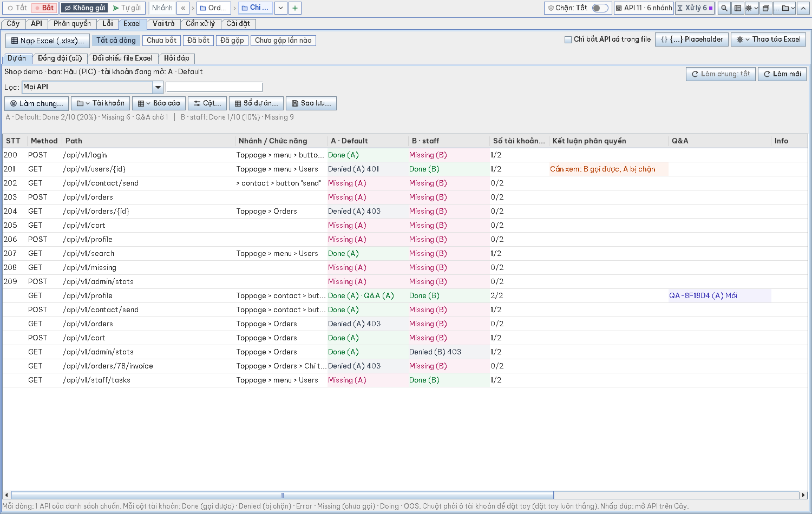
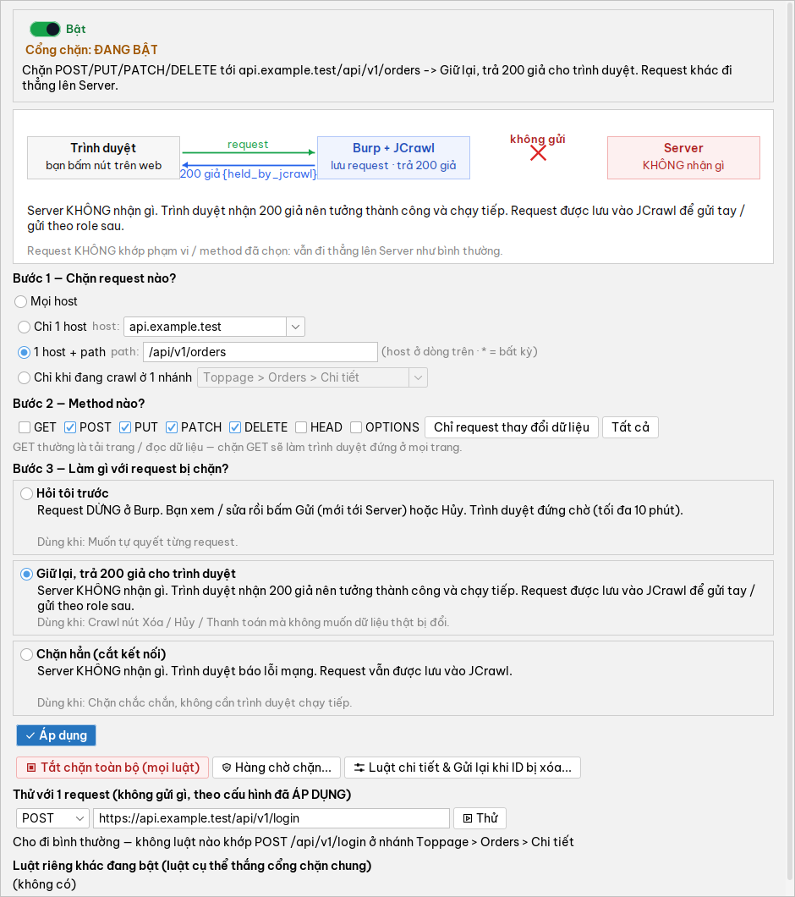
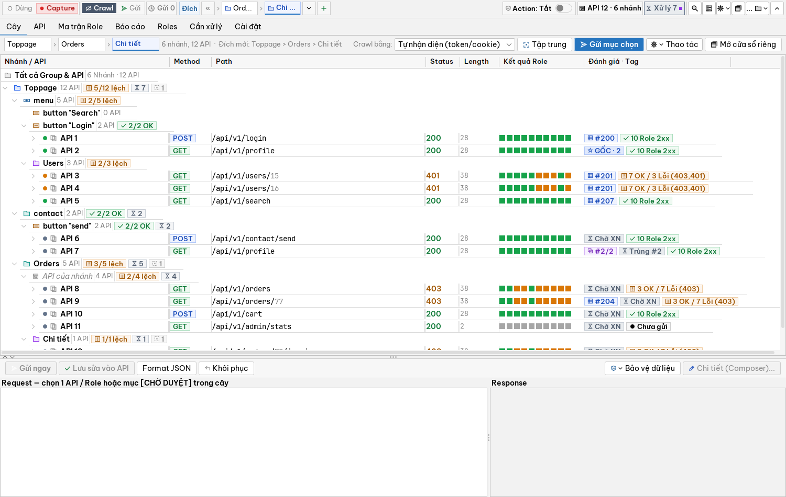
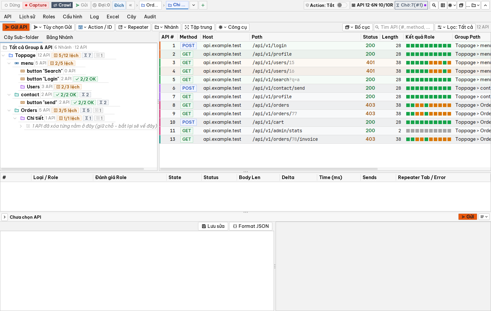
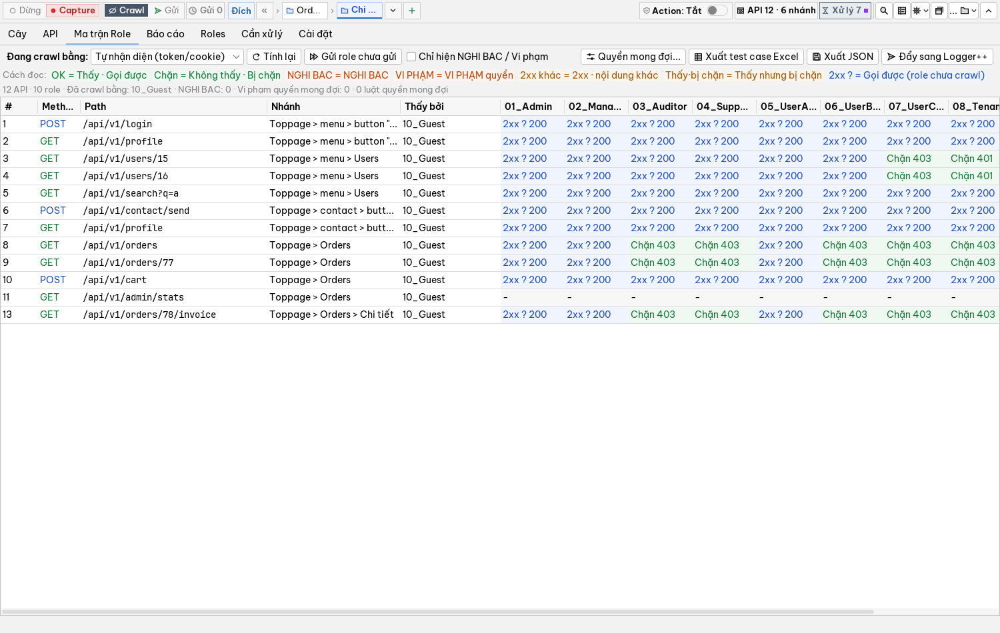
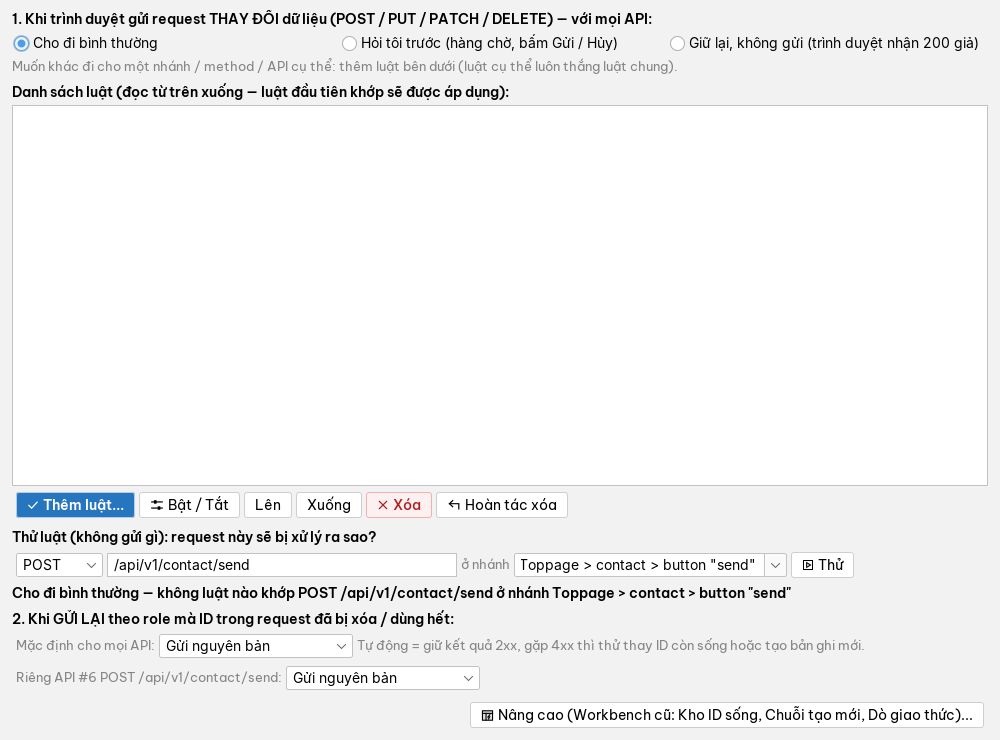
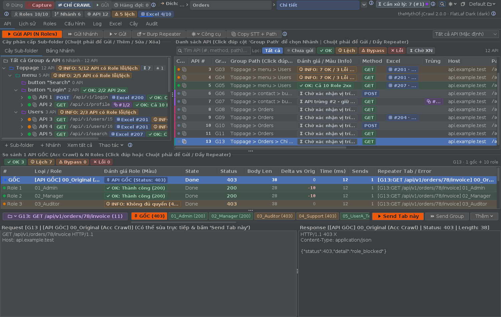

# theMythOf-JCrawl (Java / Montoya) - V_11.5

Burp Suite extension viết bằng **Java 21 + Montoya API**: bản viết lại toàn bộ của
[theMythOf-PCrawl](https://github.com/hau2212/theMythOfCrawl) (bản Python / Jython) - đủ mọi chức năng,
nhanh hơn, có lưu dữ liệu ra đĩa (workspace), **không cần Jython**, và giao diện tự thích ứng cả
**Light / Dark theme** của Burp Suite (icon vẽ hoàn toàn bằng Java2D, không phụ thuộc emoji).

## Điểm mới V_11.5

- **Đồng bộ thêm, luôn bật**: lỗi đã đánh dấu (tab Lỗi), tag, kết quả gửi lại theo vai trò của mọi tài khoản. Cột mới (bật trong **Cột...**):
  Lỗi đã đánh dấu, Tag, Kết quả theo vai trò; Excel > Dự án có lọc **Có lỗi đã đánh dấu**. Ô tài khoản ghi tên người làm: `Done (A) · An`.
- **Chia sẻ chi tiết** (mặc định **tắt**; PIC / PIC phụ bật ở Làm chung > PIC > D): mỗi người gửi thêm request / response của từng API
  (đã che token, cookie, mật khẩu, JWT; tối đa 256 KB mỗi phần) và Cây. Nội dung nằm trong thư mục Drive của dự án, Sheet chỉ giữ chỉ mục.
  Mở bằng **Excel > Dự án > Tài khoản > Xem workspace đồng đội (chỉ xem)**, hoặc nhấp đúp dòng mà chỉ đồng đội gọi được.
- **Ảnh khách hàng** dán vào file phản hồi tới đúng người tạo Q&A (gắn loại "Ảnh khách hàng") và có trong Excel của mọi người.
- **Thành viên** tự Gửi khách hàng / Nhập phản hồi cho tài khoản của mình; kết quả đồng bộ cho cả nhóm.
- **Tài khoản web** (tài khoản đăng nhập website: system, staff, guest...) tách khỏi **người làm** (hau, an, bình...). Mỗi tài khoản web
  1 cột; ô ghi người làm: `Done (an)`, `Done (hau, an)`, `Denied (an) 403`, `Done (hau) · Xung đột: Denied (an) 403`, `OOS (hau, đặt tay)`,
  `Done (khách hàng)`, `Missing`.
- **Danh sách tài khoản web dùng chung** (Excel > Dự án > Tài khoản web > Danh sách...): ai cũng thêm / đổi tên / thêm tên khác / gộp /
  tách, đồng bộ cho cả nhóm, ghi nhật ký. **Tài khoản web tiếp theo...** chọn từ danh sách (không tự gõ tên mới), gõ tên giống tài khoản
  đã có (sys ~ system) thì được hỏi.
- **Tự nhận cùng tài khoản**: cùng người đăng nhập (user trong JWT; chỉ gửi mã băm, không gửi token / tên) thì tự gộp vào 1 cột; tách lại
  được (không tự gộp lại). Hai người lỡ lấy cùng chữ cái cho 2 tài khoản web khác nhau: tự đổi sang chữ trống tiếp theo và báo.
- **Theo người làm**: lọc "Người làm" ở Excel > Dự án; Tổng quan có bảng theo người làm (API đã test, Done, Denied, Error, đặt tay, Q&A).

## Điểm mới V_11.4

Theo `VERSIONING.md`: kiến trúc dự án nhiều tài khoản + đồng bộ nhóm -> tăng MAJOR (10.4 -> 11.4). Plan chi tiết: `docs/V10_5_PLAN.md`.

### Excel > Dự án



- **Danh sách chuẩn** = file Excel chuẩn, hoặc dựng từ API tài khoản **A** (cao nhất) đã crawl, hoặc cả hai. Mọi tài khoản đối chiếu theo
  danh sách này: tài khoản con thấy **đủ mọi dòng**, dòng chưa gọi = `Missing (B)`.
- Mỗi tài khoản 1 cột: `Done (A)` gọi được · `Denied (B)` 401 / 403 · `Error` · `Missing` · `Doing` (ai đang test) · `OOS`; kèm `Info (A)` / `Q&A (A)`.
- Chuột phải ô tài khoản: **đặt tay** (luôn thắng kết quả crawl). API tài khoản khác tìm thêm hiện **Chỉ B có**, PIC chọn **Thêm vào
  danh sách chuẩn**. Cột **Kết luận phân quyền**: "Cần xem: B gọi được, A bị chặn".
- Cây > ... > **Hiện API tài khoản trên chưa gọi**: mỗi nhánh có thêm dòng mờ liệt kê API còn thiếu.

### Làm chung (Google Sheet + OneDrive của từng người)

- Mỗi người làm trong **workspace riêng** trên OneDrive của mình; **Google Sheet** là nơi đồng bộ (khoảng 12 giây / lần, 2 chiều);
  mỗi người tự có **Excel của tôi** (`excel/BangLamViec.xlsx`) đầy đủ dữ liệu cả nhóm, có ảnh, tự cập nhật.
- **PIC** (Excel > Dự án > Làm chung... > Tôi là PIC): A. dự án, B. chuyển dự án sang OneDrive, C. Google Sheet (Mở Google Sheets ->
  Tiện ích mở rộng > Apps Script -> dán mã JCrawl copy -> Triển khai > Ứng dụng web, Thực thi: Tôi, Ai có quyền: Bất kỳ ai -> dán URL ->
  Kiểm tra kết nối), D. danh sách chuẩn, E. thành viên & quyền (PIC / PIC phụ / Thành viên, giao tài khoản), F. **mã mời** (gửi riêng),
  G. theo dõi.
- **Thành viên** (Tôi là Thành viên): dán mã mời -> chọn thư mục OneDrive của mình -> Tham gia -> đăng nhập tài khoản được giao và crawl.
- Sửa tay trên Google Sheet (cột tài khoản, Ghi chú, "Khách hàng trả lời") được JCrawl kéo về. Hai người ghi khác nhau cùng 1 ô ->
  **Xung đột** cho PIC chọn (Sao lưu... > Xung đột). Chỉ gửi trạng thái, ghi chú, Q&A; **không bao giờ** gửi token / cookie.

### Báo cáo

- **Cột...**: chọn / ẩn / sắp xếp / đổi tên cột (mẫu cột: Nội bộ, Nộp khách hàng, Q&A, tự tạo). **Sổ dự án...**: thêm / xóa / đổi tên /
  lọc sheet (Tổng quan, Tổng hợp, từng tài khoản, Chênh lệch, Ngoài danh sách, Q&A, Chi tiết Q&A, Info, Phân quyền, Nhật ký, sheet lọc
  `missing:B`...) kèm thống kê.
- **Báo cáo > Xuất báo cáo**: cả dự án / tài khoản đang mở / chọn tài khoản, mỗi tài khoản 1 file. **Tổng quan** dùng công thức
  COUNTIFS (tự tính lại khi sửa Tổng hợp) + biểu đồ: Done / Denied / Missing... theo tài khoản, % phủ, hợp / giao, A và B, chỉ A, chỉ B,
  B được mà A bị chặn, Q&A theo tài khoản. File lưu vào `bao-cao/noi-bo | tung-tai-khoan | qa | khach-hang`.

### Q&A, khách hàng, sao lưu

- Q&A: mỗi ảnh là **Bước 1, 2...** / Kết quả thực tế / Kết quả mong đợi / Bổ sung / Ảnh khách hàng, có **tiêu đề + mô tả**; mức độ, cần ai
  trả lời, hạn, **trao đổi nhiều lượt**. Excel có sheet Chi tiết Q&A (bước + ảnh xếp dọc + ô trả lời).
- **Gửi khách hàng**: tạo `bao-cao/khach-hang/vong-N_ngày/goc` (giữ lại) và `chia-se` (share file này cho khách hàng trên OneDrive, Có thể
  chỉnh sửa). **Nhập phản hồi**: so với bản gốc, liệt kê câu trả lời, trạng thái, ghi chú, ảnh khách hàng dán, dòng bị xóa; PIC chọn nhận.
- **Sao lưu...**: bản lưu theo giờ (7 ngày) / ngày (30 ngày), Sao lưu ngay, So sánh & khôi phục, **Dựng lại Google Sheet từ máy này**,
  Dọn dữ liệu Sheet. Mất Sheet -> dựng lại từ máy bất kỳ; mất máy -> workspace trên OneDrive + dữ liệu nhóm trên Sheet.

## Điểm mới V_10.4

Theo `VERSIONING.md`: thêm kiến trúc họ workspace và đổi thuật toán khớp path -> tăng MAJOR (9.4 -> 10.4).

### Crawl từng tài khoản (từ cao xuống thấp)

- **Excel > Tài khoản > Tài khoản tiếp theo...** (hoặc menu Workspace): tạo **workspace con** cho tài khoản kế tiếp. Workspace con có sẵn
  **cây nhánh, luật nhánh, kiểu node và file Excel** của tài khoản trên nhưng **không có API**, nên Cây chỉ chứa API của tài khoản đó
  (không lẫn với hàng trăm API của tài khoản gốc). Workspace con nhớ workspace cha.
- Trên Cây của workspace con, mỗi API có chip **Có ở <tài khoản trên>** hoặc **Mới so với <tài khoản trên>**.
- **Excel > Tài khoản**: ma trận API x tài khoản (Có 200 / -), lọc "chỉ API không phải tài khoản nào cũng gọi được", nút **Mở tài khoản**
  để chuyển giữa các workspace trong họ, **Xuất báo cáo tổng hợp** (.xlsx): Tổng quan · Ma trận tài khoản · API từng tài khoản · Q&A.

### Hỏi đáp (Q&A / Info) có ảnh

- Chuột phải API (Cây / API) -> **Hỏi đáp (Q&A / Info)...**: câu hỏi hoặc ghi chú, **nhiều ảnh** (thêm từ file hoặc **dán Ctrl+V** ảnh
  chụp màn hình), trạng thái (Chờ trả lời / Đã trả lời / Đóng), ô **Khách hàng / dev trả lời**. API tự có tag **Q&A** / **INFO**.
- **Excel > Hỏi đáp**: quản lý mọi câu hỏi (lọc loại, trạng thái, tìm), sửa / trả lời, mở API, **Xuất Excel Q&A**: ảnh được **chèn
  thật vào ô** (mỗi ảnh một cột Ảnh 1, Ảnh 2...), có cột Khách hàng trả lời, Người trả lời, Ngày trả lời, Tài khoản khác gọi được;
  xuất riêng tài khoản này hoặc mọi tài khoản, có thể kèm báo cáo tổng hợp.

### Request bị chặn & Gửi riêng

- Mỗi request đang chờ hiện **Loại**: **API mới** / **Trùng API 12 · 3 lần bắt · nhánh** / **Đã xóa trước đây · chỗ cũ** để quyết định trước khi gửi.
- Gửi đồng loạt: chuột phải request chờ -> **Gửi N request đang chọn** / **Gửi tất cả N request đang chờ** (Hàng chặn cũng có **Gửi tất cả**).
- **Gửi riêng (không qua Logger++)**: JCrawl tự mở kết nối gửi thẳng tới server, không qua Burp, nên Logger / Logger++ không ghi
  (theo PortSwigger: request không đi qua networking của Burp thì Logger không thấy). Có ở menu **Gửi lại**, ở request đang chờ
  (trình duyệt vẫn nhận response thật) và công tắc trong **Cài đặt > Gửi request** cho mọi lần gửi.

### ID dạng chữ: cùng 1 API

- Dòng Excel `/api/a/b/{ID}`: `{ID}` khớp **mọi giá trị**, số hoặc chữ (`15`, `new`, `old`...). Request rơi vào cùng dòng `{ID}` là
  **cùng 1 API**: lần bắt đầu là bản gốc, `/api/a/b/old` sau `/api/a/b/new` là **bản trùng** (request đang chờ hiện "Trùng API n").
  API bắt trước khi nạp Excel được gộp lại tự động khi nạp / sửa Excel.
- Dòng Excel ghi path cụ thể (`/api/a/b/export`) luôn thắng dòng `{ID}`: API đó đứng riêng.
- Không có dòng Excel: chọn các API trên Cây / API -> chuột phải -> **Cùng 1 API...** -> tích đoạn path là ID -> **Gộp thành 1 API**.
  Quản lý / xóa mẫu ở **Cài đặt > Trùng lặp & vị trí > Mẫu path (ID dạng chữ)**.
- Muốn `{id}` chỉ khớp giá trị có chữ số / UUID: **Excel > {...} Placeholder** -> kiểu "Trông giống ID".

### Cây

- **Xóa API** (chuột phải / phím Delete): lần bắt trùng xóa luôn; **bản gốc** hỏi xác nhận rồi **lần bắt kế tiếp thành bản gốc**; API không
  còn lần bắt nào khác cũng hỏi trước (vẫn giữ chỗ).
- **Mở hết / Thu hết** trên thanh Cây; chuột phải nền Cây -> **Mở app: thu gọn hết Cây**.
- **Nhóm** (trước là Cụm): gom API trong một nhánh cho gọn mà không tạo nhánh con (chuột phải API -> Nhóm).

### Nhật ký

- Đổi tên thành **Nhật ký** (Menu / Tùy chọn / Cài đặt). Ghi thời gian phản hồi của từng thao tác, thao tác **chậm** (>= 300 ms), lúc
  **giao diện không phản hồi** (>= 0,8 s), **thói quen** (chuỗi 2–3 thao tác hay lặp lại để rút gọn sau này), tính năng dùng nhiều.
- **Báo lỗi**: nút nhỏ ở đầu mọi cửa sổ, Menu, hoặc **Ctrl+Alt+E**: ghi vấn đề bằng lời của bạn, kèm nơi xảy ra và 15 thao tác vừa làm.
- Xuất **Markdown** hoặc **JSONL** (mỗi dòng 1 sự kiện, dạng máy đọc). Chạy ngầm, giới hạn 4000 sự kiện, không làm chậm extension.

## Điểm mới V_9.4

- **Tài khoản crawl là dòng đầu (00) của tab Vai trò**, sửa y như vai trò khác: Thêm luật / Xóa luật / sửa giá trị / Cách
  (Thay, Thêm, Xóa, Đặt cookie, Xóa cookie). Ví dụ thêm `A: B` -> mọi request gốc JCrawl gửi đều có header `A: B`; khi Lưu, app hỏi
  có áp cho các API đã bắt không. Bật / tắt bằng công tắc của dòng.
- **Sửa request gốc an toàn**: sửa ở khung Request (dòng Tài khoản crawl) rồi bấm **Lưu request**; mọi vai trò dựng lại từ request
  mới. Lần sửa đầu tiên app giữ **bản lúc bắt**: nút **Khôi phục** (hoặc chuột phải -> *Khôi phục request lúc bắt*) đưa về đúng
  method, path, host, header, body ban đầu. Dòng Tài khoản crawl trên Cây hiện chip **Đã sửa**.
- Chuột phải API trên Cây: **Sửa request gốc (tài khoản crawl)...**.
- Nhãn lần bắt: **Gốc · còn 3 bản**; lần bắt lại khi bản gốc đã bị xóa: **Lần 5 · gốc đã xóa · còn 2 bản**.

## Điểm mới V_9.3 - một khái niệm, một tên

Rà soát toàn bộ chữ trên giao diện (khoảng 4.500 chuỗi): mỗi khái niệm chỉ còn **một tên**, nhãn ngắn, số luôn kèm chữ,
không viết hoa toàn bộ, chi tiết để ở tooltip khi rê chuột. Có test tự động chặn tên cũ quay lại.

### Từ điển

| Khái niệm | Tên dùng trong app | Tên cũ (đã bỏ) |
|---|---|---|
| Tài khoản bạn dùng khi crawl | **Tài khoản crawl** | API gốc, Acc Crawl, 00_Original, [API GỐC] |
| Tài khoản giả lập để test quyền | **Vai trò** | Role, Roles |
| Một API đã bắt | **API 12** | #12, G12, API Group |
| Lần bắt lại cùng API | **Lần 5 · gốc API 492** | #5 ← G492 |
| Lần bắt lại đang chờ bạn quyết | **Giữ lần 5?** | Trùng #5 |
| Bản đầu tiên của API | **Gốc · 3 lần** | GỐC · 3 |
| Thư mục trên Cây | **Nhánh** | Sub-folder, Group Path |
| Nhánh nhận request mới | **Nhánh đang crawl** | Đích |
| Gửi lại request | **Gửi / Gửi lại** | Send, Replay, Forward |
| Sửa request rồi gửi | **Sửa & gửi** | Composer |
| Chặn khi crawl + cách gửi lại | **Chặn & gửi lại** (1 cửa sổ) | Bảo vệ dữ liệu, Luật chặn, Action Workbench |
| Các lần bắt cùng API | **Các lần bắt** | Lineage, Bản Gốc & Trùng |
| Tìm nhanh | **Tìm** (Ctrl+K) | Spotlight |
| Dòng trong file Excel | **Excel 200** | #200 |
| API đoán là tải lại | **Tải lại?** | ? Refresh |
| Kết quả 1 vai trò | **Gọi được 200 · Bị chặn 403 · Chưa đăng nhập 401 · Nghi BAC · Chưa kết luận · Lỗi 500 · Chưa gửi** | OK: Thành công (200), INFO: Không đủ quyền (403)... |
| Tóm tắt 1 nhánh | **3/12 cần xem** · **2/2 gọi được** | 5/12 lệch, OK: 2/2 API 2xx |
| Chip đếm trên nhánh | **7 chờ** · **1 đã xóa** | ⧗ 7 · ⊡ 1 |
| Hoạt động của app | **Hoạt động** (Cài đặt) | Log |
| Xuất nhật ký cho Claude | **Nhật ký cho Claude** | |

### Giao diện

- **Thanh trên**: Bắt request **Tắt | Bắt** · gửi tự động **Không gửi | Tự gửi** · **Chờ gửi N** chỉ hiện khi đang có request chờ ·
  **Xử lý N** · **Nhánh** đang crawl · **Chặn: Tắt / Hỏi trước / 200 giả / Cắt**.
- **Tab**: Cây · API · Phân quyền · Lỗi · **Excel** · Vai trò · **Cần xử lý** · Cài đặt (Alt+1..8).
  - Excel là tab riêng (trước nằm trong Báo cáo): *Xuất & làm việc nhóm* · *Đối chiếu file Excel*.
  - Lịch sử nay là chế độ xem trong Cây: nút **Theo nhánh | Theo thời gian** trên thanh công cụ của Cây.
  - Cần xử lý (trước là Duyệt): *Chờ xác nhận* · *Giữ chỗ* · *Lần bắt trùng* · *Lịch sử chỗ*.
- **Chặn & gửi lại**: một cửa sổ, 6 trang: **Tổng quan** (2 câu hỏi: khi crawl chặn hay cho đi; khi gửi lại ID đã dùng thì làm gì)
  · Chế độ · Luật · Kiểm tra · ID & 200 · Hướng dẫn. Mọi nút "Bảo vệ dữ liệu" / "Luật chặn" cũ mở cửa sổ này.
- **Bảng API**: cột Dòng · Vai trò · Kết quả · Trạng thái · Mã · Độ dài · Chênh · Thời gian · Lần gửi · Ghi chú; bộ lọc
  **Đúng hết / Cần xem / Nghi BAC / Lỗi / Chưa gửi / Chờ xác nhận**.
- **Phân quyền**: chú giải gọn (Đúng · Bị chặn · Nghi BAC · Vi phạm · Khác nội dung · Thấy · bị chặn · Chưa rõ), rê chuột để xem nghĩa.
- **Vai trò**: nút **Kiểm tra phiên** (Còn hạn 200 / Hết hạn 401 / Bị chặn 403).
- **Excel**: bảng hiện Đã bắt / Cần xem / Chưa bắt / Ngoài phạm vi / Xung đột / Đang làm. File Excel và Google Sheets vẫn ghi mã
  Done / Info / Missing / OOS / Conflict / Doing để đồng đội dùng bản cũ vẫn đọc được.
- Dữ liệu workspace cũ mở bình thường; dòng "[API GỐC] 00_Original (Acc Crawl)" tự hiện thành "Tài khoản crawl".

## Điểm mới V_9.2 (bản chính thức)

Bản dùng lâu dài: gom V_8.2_beta + nâng thuật toán gửi lại theo vai trò và cách kết luận lỗi phân quyền (theo `VERSIONING.md`:
đổi thuật toán lõi -> tăng MAJOR, 8.2 -> 9.2; kênh `stable`, không còn nhãn beta).

### Gửi lại theo vai trò (chuột phải API trên Cây / API -> **Gửi lại**)

| Mục | Gửi những dòng nào |
|---|---|
| Tất cả | tài khoản crawl + mọi vai trò đang bật |
| Chỉ vai trò | mọi vai trò (như nút Gửi) |
| Chỉ tài khoản crawl | chỉ request gốc |
| Chỉ &lt;vai trò&gt; | đúng vai trò đang chọn trên Cây |
| Chỉ dòng lỗi / nghi BAC | dòng 4xx / 5xx / lệch / NGHI BAC để kiểm tra lại |
| Chọn vai trò... | hộp chọn vai trò (như trước) |
| **Mỗi vai trò 1 bản ghi riêng** | DELETE / PUT / PATCH / POST cho N vai trò, mỗi vai trò 1 ID khác nhau |

### DELETE gửi cho 10 vai trò: làm sao cả 10 lần đều có kết quả thật?

Gửi cùng 1 ID thì vai trò đầu tiên xóa mất bản ghi, 9 vai trò sau chỉ nhận 404 - trông như "bị chặn đúng" nhưng thật ra server
chưa hề kiểm tra quyền (dễ bỏ sót BOLA). **Mỗi vai trò 1 bản ghi** làm như sau:

1. Tìm API tạo **cùng họ API** (vd `POST /api/orders` cho `DELETE /api/orders/{id}`); có thì **tài khoản crawl tạo trước** 1 bản ghi
   cho mỗi vai trò (bản ghi thuộc tài khoản crawl = nạn nhân), lấy ID từ response 2xx.
2. Không có API tạo: lấy các ID **khác nhau** còn dùng được trong **Kho ID** cùng họ API.
3. Gửi DELETE của từng vai trò với ID riêng; **tài khoản crawl gửi cuối** với bản ghi riêng làm dòng đối chứng (mong đợi 2xx).
4. Mỗi dòng ghi lại **ID đã dùng** (cột *Ghi chú* bảng API, chip trên Cây) và **request thật đã gửi** (khung Request hiện đúng
   request ra response đó; HAR / Repeater cũng dùng request này).

Chế độ **Tự động / Đổi ID / Tạo trước** (Luật chặn -> Chế độ, hoặc Bảo vệ dữ liệu câu 2) dùng đúng cách này mỗi khi gửi nhiều vai trò
cùng lúc. Chế độ **Tắt** gửi y nguyên; dòng 404 / 410 do ID đã bị dòng khác dùng sẽ hiện **"Chưa kết luận: ID đã dùng"** thay vì "bị chặn".

### Kết luận lỗi phân quyền ngay trên Cây

Trước đây vai trò thấp gọi được API admin vẫn hiện xanh "OK: Thành công". Nay dòng vai trò hiện kết luận của tab Phân quyền:
**NGHI BAC** (vai trò không thấy chức năng khi crawl mà vẫn gọi được, nội dung giống tài khoản crawl), **VI PHẠM** (trái Quyền mong đợi),
**Chưa kết luận: ID đã dùng**. Dòng nghi BAC -> chuột phải -> *Đánh dấu lỗi...* để đưa vào tab Lỗi.

### Nhật ký cho Claude (Menu / Tùy chọn / Cài đặt mục 8)

Mọi thao tác được ghi theo thứ tự: bấm nút, chọn menu, đổi tab, đổi cài đặt (giá trị trước -> sau), từng lần gửi (API, vai trò, status,
ID đã dùng, chế độ), thông báo của app, lỗi kèm stack trace. **Nhật ký cho Claude** tạo 1 file Markdown gồm Môi trường, Trạng thái
hiện tại, Lỗi gần đây, Dòng thời gian - Copy hoặc Lưu .md rồi gửi cho Claude để nhờ phân tích. Token, cookie, JWT, mật khẩu, tham số
`token=` đều bị che **trước khi** ghi; không có body request / response. File `activity.jsonl` được ghi vào thư mục workspace khi đóng /
đổi workspace hoặc khi mở Nhật ký.

### Logger++ / server quản lý test case

Header đánh dấu `X-JCrawl-Ref` có thêm `bug=API1,API5` khi API có lỗi đang mở (mã OWASP API Top 10 2023), để server gắn test case.

## Điểm mới V_8.2_beta

- **Đánh dấu lỗi (tab Lỗi, Alt+4)**: chuột phải API (Cây / API) hoặc ô trong tab Phân quyền -> *Đánh dấu lỗi...*. Loại lỗi theo
  OWASP API Security Top 10 (2023) với tên ngắn: Dữ liệu người khác (API1 BOLA/IDOR), Vượt quyền (API5 BFLA), Trường cấm (API3 BOPLA),
  Đăng nhập (API2), Không giới hạn (API4), Nghiệp vụ (API6), SSRF (API7), Cấu hình (API8), Lộ thông tin, Khác. Mức độ, trạng thái
  (Nghi ngờ -> Đã xác nhận -> Đã báo -> Đã sửa / Bỏ qua), vai trò, ghi chú. Tab Lỗi có thống kê theo mức độ và loại, lọc, xuất Excel / JSON;
  API có lỗi mang tag **BUG**.
- **Kho ID theo họ API**: chỉ lấy ID từ response **2xx** của **cùng họ API** (`DELETE /api/a/b/c/15` dùng ID do `POST /api/a/b/c` tạo,
  hoặc từ `GET /api/a/b/c` danh sách). DELETE thành công -> ID đánh dấu đã dùng. Bảng Kho ID hiện **Lấy từ** (tạo mới / danh sách /
  đọc được / sửa được / nhập tay) và **API nguồn**.
- **Thanh trên thu gọn được**: chỉ giữ Capture, Crawl/Gửi và Chặn; mọi thứ khác (Đích, Hàng đợi, Trạng thái, Tìm nhanh, Tùy chọn,
  Workspace) vào nút **Menu**.
- **Tên gọi ngắn, rê chuột để xem chi tiết**: chế độ thao tác = Tắt · Tự động · Giữ lại · Bằng chứng 200 · Đổi ID · Tạo trước · Chờ duyệt.
  Cửa sổ "Action Workbench" đổi thành **Luật chặn** với 5 tab: Chế độ · Luật · Kiểm tra (Nhật ký / Thử luật) · ID & 200 · Hướng dẫn.
- **Tab Vai trò mới**: cột *Đăng nhập bằng* hiện Token / Cookie / Không token / Hết hạn thay cho REPLACE: Authorization; thống kê gọn 1 hàng.
- **Cài đặt mục 8**: hiện Sáng / Tối, Màn hình 100%... thay cho mã kỹ thuật (mã vẫn xem được khi rê chuột / Copy chẩn đoán).
- Sửa lỗi: phần Thử luật bị chồng chữ khi cửa sổ hẹp.

## Điểm mới V_7.2_beta

- **Cổng chặn Proxy gọn**: chọn lựa chọn nào thì mới hiện cấu hình của lựa chọn đó (host / host + path / nhánh; giải thích của
  đúng cách chặn đang chọn); phần Thử & luật khác thu gọn; vừa một màn hình, không tràn ngang.
- **Cuộn chuột nhanh** trong mọi cửa sổ và tab (khoảng 3 dòng mỗi nấc thay vì 1 px).
- **Action Workbench = màn hình nâng cao** của cùng danh sách luật mà nút "Chặn: …" và Bảo vệ dữ liệu dùng. Tab "CRUD" đổi tên thành
  **Danh sách luật (thêm / sửa / xóa)**; form tạo luật chỉ mở khi bấm **Tạo luật mới** hoặc chọn 1 luật để sửa (nút **Ẩn form** để thu lại).

## Điểm mới V_7.1_beta — Cổng chặn Proxy trực quan



Bấm nút **Chặn: ...** trên thanh trên cùng (hoặc menu *Bảo vệ dữ liệu → Cổng chặn Proxy*). Một công tắc + 3 câu hỏi:

| Bước | Hỏi | Lựa chọn |
|---|---|---|
| 1 | **Chặn request nào?** | Mọi host · Chỉ 1 host · 1 host + path (`/api/orders` = mọi path bên dưới, `*` = bất kỳ) · Chỉ khi đang crawl ở 1 nhánh |
| 2 | **Method nào?** | Tích chọn GET / POST / PUT / PATCH / DELETE / HEAD / OPTIONS (mặc định chỉ POST, PUT, PATCH, DELETE) |
| 3 | **Làm gì với request bị chặn?** | **Hỏi tôi trước** (dừng ở Burp, bạn bấm Gửi/Hủy) · **Giữ lại, trả 200 giả cho trình duyệt** · **Chặn hẳn** |

- **"200 giả" nghĩa là gì?** Response 200 giả được trả về cho **trình duyệt**, không phải cho Server: Server **không nhận gì**, trình duyệt tưởng
  thành công và chạy tiếp, request được lưu trong JCrawl để gửi tay / gửi theo role sau. Dùng khi crawl nút Xóa / Hủy / Thanh toán mà không muốn đổi dữ liệu thật.
- **Sơ đồ luồng** Trình duyệt → Burp + JCrawl → Server vẽ lại ngay khi bạn đổi lựa chọn; câu tóm tắt cho biết chính xác cái gì bị chặn, cái gì đi thẳng.
- **Thử với 1 request**: nhập method + URL → biết ngay request đó sẽ bị xử lý ra sao (không gửi gì).
- Công tắc trên thanh trên cùng: BẬT = dùng thiết lập đã lưu · TẮT = tắt mọi chặn, request đi thẳng.
- **Nút bấm luôn có phản hồi**: bấm nút cần chọn dòng trước (Lên / Xuống / Xóa / Bật-Tắt / Format JSON / Gửi / Repeater…) khi chưa chọn
  sẽ hiện nhắc "Chọn … trước"; nếu thao tác gặp lỗi, lỗi hiện ngay cạnh nút và ghi vào tab Cài đặt → Log (trước đây lỗi bị nuốt, trông như
  "bấm không ra gì"); mọi dialog luôn mở trên cửa sổ Burp đang dùng, không bị khuất phía sau.
- Dialog **Bảo vệ dữ liệu**: câu 1 trỏ về Cổng chặn; câu 2 (gửi lại khi ID đã bị xóa) có thẻ **Đầu vào → Đầu ra** cho từng cách
  (Tự động / Gửi nguyên bản / Thay ID còn sống / Tạo bản ghi mới rồi gửi / Dùng lại kết quả 200 cũ).

## Điểm mới V_7.0_beta

Kế hoạch & giải thích đầy đủ: [`docs/V7_PLAN.md`](docs/V7_PLAN.md).

### 1. Tab Cây dạng bảng thẳng hàng (tab mở mặc định)



- Nhánh vẫn thụt lề như cây, nhưng **mọi dòng API / role / [CHỜ DUYỆT] vẽ trên cùng một lưới cột**:
  `Nhánh / API | Method | Path | Status | Length | Kết quả Role | Đánh giá · Tag` — API ở nhánh sâu hay nông đều thẳng hàng.
- Kéo mép tiêu đề cột để đổi độ rộng (nhớ lại lần sau), nhấp đúp mép cột để về mặc định.
- `Ctrl+Alt+2` ẩn/hiện khung Request/Response dưới cây · `Ctrl+Alt+0` chỉ còn cây · ô **Crawl bằng** chọn role đang crawl.

### 2. Tab API kiểu Burp HTTP History



- Cột `# | Method | Host | Path | Status | Length | Kết quả Role | Nhánh | Đánh giá | Cách gửi lại | Time`; cột ít dùng ẩn mặc định (chuột phải header để bật).
- Cây bên trái chỉ còn nhánh + số đếm để lọc bảng; kéo dòng API thả vào nhánh để chuyển.
- `Ctrl+Alt+1/2/3/H` ẩn/hiện Cây / Chi tiết / Thanh công cụ / Thanh trên cùng · `Ctrl+Alt+0` chế độ Tối đa · nút **Bố cục ▾**.

### 3. Crawl N role không trùng & phát hiện BAC — tab **Ma trận Role**



- Extension **tự nhận ra role đang crawl** bằng cách so token / cookie của request với rule từng Role (hoặc chọn tay ở ô *Đang crawl bằng*).
- API đã có mà role khác cũng thấy → **không tạo bản trùng**, chỉ ghi thêm vào cột **Thấy bởi**.
- Gửi lại mọi API bằng mọi role → **Gọi được**. Role **không thấy** chức năng trong UI nhưng **gọi được 2xx cùng nội dung** (so độ giống body)
  → **NGHI BAC**. Khai báo **Quyền mong đợi** theo nhánh (ví dụ `Toppage > Admin` chỉ `01_Admin`) → **VI PHẠM** chắc chắn.
- Xuất **test case** (Excel 2 sheet / JSON) cho server quản lý.

### 4. Đẩy sang Logger++ / Xuất HAR

- Nút **Đẩy sang Logger++**: gửi lại mỗi API **1 lần** qua HTTP client của Burp (Logger++ bật log tool *Extensions* sẽ ghi request + response thật).
  Mặc định chỉ API gốc **2xx** và chỉ **GET/HEAD** (POST/PUT/PATCH/DELETE phải bật riêng + xác nhận). Tùy chọn header `X-JCrawl-Ref: API#..;role=..;branch=..`
  để lọc trong Logger++ (mặc định tắt để không để lại dấu vết lạ trên server mục tiêu).
- **Xuất HAR** (không gửi gì) kèm trường `_jcrawl` (API #, nhánh, Thấy bởi, role, đánh giá).

### 5. Làm việc nhóm an toàn với SOC

| Cách | Mạng từ Burp | Ghi chú |
|---|---|---|
| **Thư mục chung** (khuyến nghị) — OneDrive / SharePoint / Google Drive / ổ mạng | **Không** | Mỗi người ghi `jcrawl-team/<tên>.jsonl`, đọc file của người khác mỗi 3 giây; tự nối lại khi mở Burp |
| **Excel nhóm** 6 sheet (Tổng hợp, Ma trận Role, Test case & Bug, Phân công, Xung đột, Theo thành viên) | **Không** | Mỗi người xuất 1 file, một người **Gộp** lại; phát hiện xung đột kiểu Git |
| Google Sheets (đã có) | HTTPS tới Google | Giới hạn Web App trong tổ chức |
| Phòng LAN | Mở cổng | Mặc định chỉ `127.0.0.1`, bắt buộc passcode ≥ 8 ký tự; mở LAN phải bật riêng có cảnh báo |

Chỉ chia sẻ metadata (method, host, path, trạng thái, tag, người tìm) — không bao giờ chia sẻ token / cookie.

### 6. Bảo vệ dữ liệu (thay cho mục Action khó hiểu — từ V_7.1 câu 1 là Cổng chặn Proxy)



- **Câu 1** — khi trình duyệt gửi POST/PUT/PATCH/DELETE: *Cho đi bình thường* / *Hỏi tôi trước* / *Giữ lại, không gửi (200 giả)*;
  thêm luật riêng cho method / nhánh / API. Luật hiển thị bằng câu tiếng Việt, đọc từ trên xuống.
- **Thử luật**: nhập method + path + nhánh → biết ngay request sẽ bị xử lý ra sao (không gửi gì).
- **Câu 2** — khi gửi lại mà ID đã bị xóa: *Gửi nguyên bản* / *Thay ID còn sống* / *Tạo bản ghi mới rồi gửi* / *Dùng lại kết quả 200 cũ* / *Tự động*;
  cột **Cách gửi lại** trong bảng API cho biết lần gửi gần nhất đã làm gì.
- Nút **Gộp vào danh sách luật** chuyển mọi công tắc chặn kiểu cũ (giữ ở Proxy, chặn chờ theo nhánh/API, luật Proxy cũ) thành luật — hành vi giữ nguyên, chỉ còn **một nơi** để xem.
  Workbench cũ vẫn ở mục **Nâng cao**.

### 7. Tab gọn hơn

`Cây · API · Ma trận Role · Báo cáo (Lịch sử, Excel) · Roles · Cần xử lý · Cài đặt (Cấu hình, Log)` — `Alt+1..7`.
Thanh trên cùng dùng chữ rõ nghĩa: `API 12 · 6 nhánh`, `Xử lý 7`, `Gửi 0`.

## Giao diện (Light & Dark)

| Tab API (FlatLaf Light) | Tab API (FlatLaf Dark) |
|---|---|
|  |  |

| Lịch sử trực quan - Heatmap theo Role (Dark) | Tab Roles & JWT Inspector (Light) |
|---|---|
|  |  |

## Cài đặt - chỉ cần 1 file

1. Tải **`theMythOf-JCrawl.jar`**: [link tải trực tiếp](https://github.com/hau2212/theMythOf-JCrawl/releases/latest/download/theMythOf-JCrawl.jar)
   (hoặc mục **Releases** bên phải trang repo). GitHub tự build lại mỗi lần có commit mới trên `main`.
2. Để file vào **một thư mục riêng**, ví dụ `D:\Tools\JCrawl\theMythOf-JCrawl.jar`.
   Dữ liệu sẽ được lưu ngay cạnh file: `D:\Tools\JCrawl\theMythOfCrawl_workspace\`.
3. Burp → **Extensions → Installed → Add** → Extension type **Java** → chọn file `.jar` → Next.
   Tab **`theMythOf-JCrawl`** xuất hiện trên thanh tab của Burp.

Không cần cài Jython, Python hay thư viện nào khác. Cần Burp Suite bản mới (có sẵn Java 21; bản 2024 trở lên).

**Cập nhật bản mới:** tải jar mới, ghi đè đúng file cũ (cùng thư mục) → trong Burp, Ctrl + click ô
*Loaded* của extension để nạp lại. Workspace (dữ liệu đã bắt) giữ nguyên.

**Tự build** (cần JDK 21): `gradlew.bat build` (hoặc `./gradlew build` trên Linux/macOS) → file ở
`build/libs/theMythOf-JCrawl.jar` (khi chạy từ `build/libs`, workspace nằm ở thư mục gốc của repo).

### Gặp lỗi giao diện (mất màu / ô vuông emoji / vẫn thấy giao diện cũ)

1. Mở **Extensions → Installed → chọn `theMythOf-JCrawl` → Output**, kiểm tra dòng nạp:
   `theMythOf-JCrawl 2.0.0 loaded · LAF=... · dark=...`
2. Kiểm tra tên tab trên thanh tab Burp là **`theMythOf-JCrawl`**. Nếu không có dòng Output trên hoặc tên tab vẫn là tên cũ → Burp đang nạp file `.jar` cũ; hãy **Unload / Remove** extension cũ và **Add** lại file `theMythOf-JCrawl.jar` mới nhất.
3. Mở tab **Cấu hình → mục 8. Giới thiệu & chẩn đoán** (hoặc rê chuột vào chip trạng thái trên header) để xem phiên bản, LAF, màu `Panel.background` / `Table.background` / `Component.accentColor`, hệ số scale và cỡ chữ (`90% / 100% / 115%`); bấm **Copy thông tin chẩn đoán** nếu cần gửi kèm ảnh chụp màn hình.

## Dùng nhanh

1. Tab **Roles**: sửa các role mẫu (token / cookie / JWT của từng tài khoản test), tắt role không dùng bằng switch gạt.
   Thẻ **API gốc** ghim trên cùng áp rule trực tiếp lên request đã bắt (nếu bật).
2. Thanh trên cùng (2 hàng gọn): bấm vào **Đích** (dạng **Breadcrumb** tô màu từng cấp) hoặc mũi tên bên cạnh để chọn
   nhánh đích, ví dụ `Toppage > contact > button "send"` - mọi request mới sẽ vào nhánh này cho tới khi bạn đổi.
3. Bật nút gạt **Dừng / Capture** (có chấm đỏ nhấp nháy nhẹ khi đang bắt), duyệt web qua Proxy của Burp. Mỗi API được
   bắt sẽ nhân bản thành 1 API gốc + N role.
4. Gạt **CHỈ CRAWL / GỬI** sang **GỬI** (tự gửi mọi role theo hàng đợi chống 429 có thanh tiến độ mảnh), hoặc chọn API /
   nhánh rồi bấm **Gửi** (`Ctrl+Enter`). Màu trạng thái: xanh lá = OK, vàng hổ phách = role bị chặn / lệch quyền, cam =
   nghi bypass (Guest vẫn 2xx), đỏ = lỗi server, xanh dương = 3xx / chưa gửi, xám = chờ xác nhận vị trí.
5. Pill **Cần xử lý** (thanh trên cùng / tab **Audit**): xác nhận vị trí API mới, API quay về chỗ cũ, API trùng.
6. (Tùy chọn) Tab **Excel** → nạp danh sách API (`STT | PROTOCOL | PATH | POSITION`) để theo dõi độ phủ qua KPI **StatCard**;
   bấm icon Copy ở đầu dòng hoặc `Ctrl+Shift+C` để copy `STT. path`.
7. Xuất kết quả: tab **Lịch sử** → **Xuất** (Excel 7 sheet, báo cáo `.md`, ma trận JSON).

Mọi thao tác chính đều hiển thị thông báo nổi không chặn (**Toast trượt**) kèm nút **Hoàn tác** khi kéo thả di chuyển API, và có icon trợ giúp hình chữ `i` mở popover chi tiết.

## Các tab & điểm mới

| Tab | Nội dung & Cải tiến |
|---|---|
| **Thanh trên cùng** | Thiết kế 2 hàng (`<= 64 px`) vừa màn hình hẹp 1100 px: toggle **Dừng / Capture**, **CHỈ CRAWL / GỬI**, **Hàng đợi**, **Đích** dạng Breadcrumb từng cấp, pill **Cần xử lý**, tìm kiếm nhanh `Ctrl+K`, tùy chọn, tách cửa sổ, Workspace và dải chip thống kê bấm-lọc nhanh |
| **API** | Cây Sub-folder hỗ trợ **kéo thả API sang nhánh khác** (có Hoàn tác) và chip bấm trực tiếp Copy / Excel / Trùng; bảng API có **ô lọc nhanh (`Ctrl+F`)**, **dải chip lọc nhiều trạng thái cùng lúc**, **nhớ độ rộng / thứ tự / ẩn cột** (chuột phải lên header cột để chỉnh, key `tmoc.ui.columns.*`); bảng kết quả role kèm dải tổng hợp `OK / Lệch / Bypass / Lỗi` và luôn ghim hàng **GỐC** ở đầu khi sort; editor Pretty / Raw / Hex của Burp giữ nguyên bên dưới |
| **Lịch sử** | Báo cáo trực quan **HistoryReportView**: dải 8 **StatCard KPI** (nhánh, API, OK, Lệch, Bypass, Lỗi, Chưa gửi, % Excel) + 3 chế độ xem (**Thẻ** theo nhánh kèm ma trận ô vuông heatmap từng role — bấm để nhảy tới đúng API & Role ở tab API; **Ma trận** bảng Role × API tô màu trạng thái; **Văn bản** thuần để đọc/copy) |
| **Roles** | Thẻ **API gốc** ghim đầu; danh sách role dạng thẻ với avatar tròn 2 chữ cái, switch gạt và chip rule màu theo mode (`REPLACE`, `ADD`, `REMOVE`, `COOKIE_SET`, `COOKIE_REMOVE`); **JWT Inspector** tô màu cú pháp JSON header/payload kèm nhãn cảnh báo `exp` hết hạn / còn hạn |
| **Cấu hình** | 8 mục thẻ màu bố cục lưới 2 cột (tự chuyển 1 cột khi hẹp), ô tìm kiếm cài đặt ở trên cùng, placeholder + viền đỏ khi regex sai; **Mục 8** thêm chỉnh **cỡ chữ giao diện (`90% / 100% / 115%`)**, bật/tắt animation nhẹ (`<= 150 ms`) và copy thông tin chẩn đoán |
| **Log** | Cây tải lười nhánh → API → dòng log (giờ monospace + icon Java2D theo loại + tô màu dòng lỗi) kèm ô tìm kiếm và chip lọc **Bắt / Gửi / Lỗi / Di chuyển / Hệ thống** |
| **Excel** | Màn hình chờ **EmptyState** khi chưa nạp file; 4 thẻ KPI độ phủ + chip lọc nhanh + bảng timeline lịch sử các lần gặp (icon kết quả, giờ, vị trí đang đứng → nhánh lưu) |
| **Cây** | Cây lớn kèm thanh **Breadcrumb** theo nhánh/API đang chọn, đồng bộ tiêu đề cửa sổ khi bấm **Mở cửa sổ riêng** |
| **Audit** | 4 tab con dạng thẻ (`tabType=card`) có số đếm: **Cần xử lý** kèm thẻ **Chi tiết quyết định** chứa nút xử lý trực tiếp, **Giữ chỗ**, **API trùng & ẩn**, và **Nhật ký** tô màu theo hành động (hoàn tác được) |

## Phím tắt

| Phím tắt | Chức năng |
|---|---|
| `Ctrl+K` | Mở **Spotlight** tìm kiếm toàn cục (nhảy nhanh tới API theo `#gid` / path / STT Excel, Nhánh, hoặc Role) |
| `Ctrl+F` | Focus ô lọc / tìm kiếm trong tab hiện tại |
| `Ctrl+Shift+C` | Copy `STT. path` cho các API / nhánh đang chọn |
| `Ctrl+Enter` | Gửi API / phạm vi đang chọn qua N Roles |
| `Ctrl+R` | Đẩy API / phạm vi đang chọn sang Burp Repeater |
| `Alt+1` .. `Alt+7` | Chuyển nhanh giữa 7 tab chính (Cây, API, Ma trận Role, Báo cáo, Roles, Cần xử lý, Cài đặt) |
| `Delete` | Xóa các API đang chọn (có hộp thoại xác nhận, vẫn giữ chỗ) |

## Workspace - dữ liệu không mất khi tắt Burp / đổi project

Mọi thứ (request / response, kết quả từng role, cây nhánh, giữ chỗ, file Excel, lượt gặp, bộ đếm, cấu hình cột bảng, cỡ chữ và animation) lưu vào thư mục **`theMythOfCrawl_workspace`** trong thư mục dự án chứa file `.jar`
(chạy từ `build/libs` thì là thư mục gốc của repo):

```
theMythOfCrawl_workspace\
└── <Tên project Burp>\
    └── <Tên workspace>\
        ├── workspace.json      tên, thời gian tạo
        ├── state.json          nhánh, giữ chỗ, Excel, lượt gặp, quy tắc role, bộ đếm
        └── apis\<số API>\      meta.json + request / response gốc và của từng role
```

- Tự lưu mỗi 2 giây, chỉ ghi phần thay đổi; ghi kiểu nguyên tử (tắt Burp đột ngột không hỏng file).
- Mở lại Burp: tự mở workspace dùng gần nhất của project đó. Menu **Workspace**: tạo / mở / xóa, mở thư mục, đổi thư mục gốc.
- `theMythOfCrawl_workspace/` nằm trong `.gitignore`: dữ liệu bắt được (có token, cookie) không bao giờ bị đẩy lên GitHub.

## Hiệu năng (đo bằng `Bench`, 5000 API × 10 role)

| Thao tác | Thời gian |
|---|---|
| Bắt 5000 API (nhân bản 10 role) | ~4.1 s (~0.83 ms / API) |
| Dựng lại cây 5000 API | ~55 ms (mục tiêu <= 80 ms) |
| Nạp lại bảng API 5000 dòng | ~121 ms (mục tiêu <= 150 ms) |
| Dựng báo cáo Lịch sử trực quan (`HistoryReportView`) | ~31–44 ms |
| Lưu workspace | ~0.2–0.5 s |
| Mở lại workspace 5000 API | ~1.7 s |
| Xuất Excel 7 sheet | ~1.2 s |
| Bộ nhớ giữ lại | ~193 MB |

Giao diện chỉ cập nhật phần thay đổi (gom mỗi 200 ms), cây và danh sách thẻ lịch sử chỉ dựng phần tử đang nhìn thấy (virtualization / lazy tree), tab ẩn không vẽ lại, renderer cache màu/font/chip không tạo object thừa khi vẽ.

## Dựng request cho từng role

`src/main/java/themythofcrawl/rolereq/RoleRules.java` dựng request của mỗi role (header / cookie / JWT)
và của profile API gốc từ request đã bắt - giống bản Python. Hành vi được giữ bằng `RoleRulesTest`
(chuyển từ các test của bản Python).

## Kiểm thử

```bat
gradlew.bat test
```

- `CoreTest`, `EngineTest`, `SendDispatcherTest`, `WorkspaceTest`: lõi, bắt / gửi / 429 / giữ chỗ / trùng, lưu & mở lại.
- `RoleRulesTest`: request của từng role (thay / thêm / xóa header, cookie, JWT, profile API gốc, chạy song song).
- `ThemeContrastTest`: kiểm tra độ tương phản WCAG AA (>= 4.5:1 cho token, >= 3:1 cho chữ phụ) trên nền sáng/tối, kiểm tra mọi kit component & icon Java2D, và ràng buộc zero FlatLaf import / zero `new Color(` ngoài `Theme` / zero emoji literal trong `ui/`.
- `ThemedComponentTest`: kiểm tra `ThemedTree`/`ThemedTable` bảo toàn renderer qua `applyTheme` & runtime switch `FlatLightLaf / FlatDarkLaf / FlatIntelliJLaf / FlatDarculaLaf`, bố cục header 1100 px, `HistoryReportView` với 5000 API, `SpotlightDialog`, kéo thả + Hoàn tác, `ColumnMemory`, cỡ chữ, `SearchField`.
- `UiSmokeTest`, `ExtensionLoadTest`: dựng giao diện headless, nạp extension đúng chuẩn Montoya và lưu ra đĩa.
- `UiPreview` / `Bench` (trong `src/test`): chụp ma trận ảnh màn hình trên 4 theme FlatLaf (`-Dlaf=...`, `testImplementation` only — không đóng gói vào `.jar`) và benchmark 5000 API.
